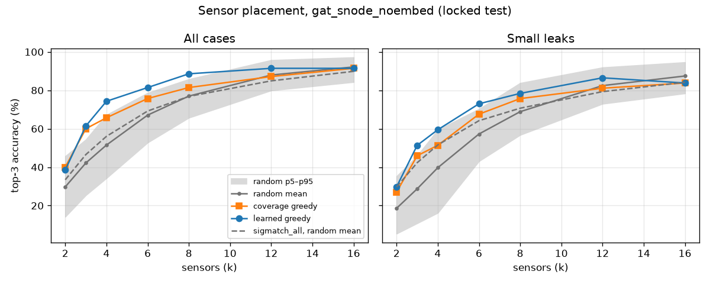
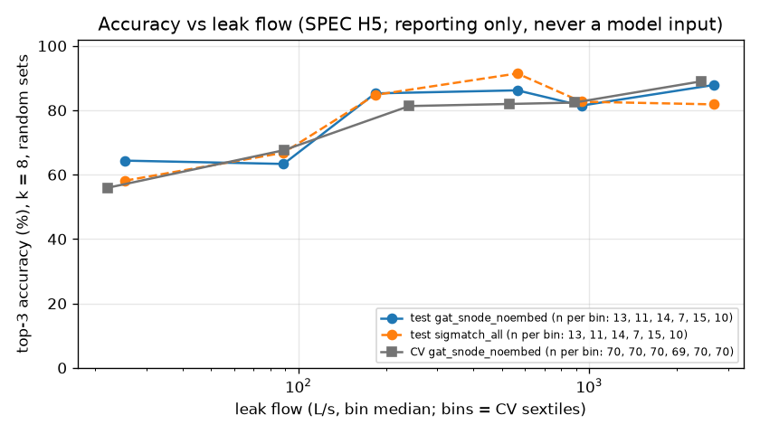

# LeakSense: final report (locked test)

- **Generated by:** `leaksense final-report`, config `final`, commit `bb6bf1fdb1` (dirty), data manifest `6281be1c3cf2`, features `e4875b0348a0` (`7eac2c84b2fd`), splits sha `c169a28e2450`, seed 0.
- **Training:** every rung is fit once on 419 CV cases (inner validation split for early stopping and grids, then a refit, as in CV). Training seeds: mlp 0; gbm 0; gat 0,1,2; gat_noembed 0,1,2; gat_snode 0,1,2; gat_snode_noembed 0,1,2. With several seeds, per-case metrics are averaged over them.
- **Locked test set:** 70 cases from 70 scenarios; leak type {'small': 37, 'big': 33}; kind {'solo': 36, 'pure': 34}; baseline {'pre': 65, 'post': 5}. Median leak flow (L/s): big 939, small 89.
- **Sensor sets:** k < 31 averages each case over the same 20 seeded random sets per k as every CV report. The placement section uses the M11 final placement.
- **Metrics:** tie-aware top-k; hop and network distance (m) from the top-1 pipe's midpoint to the true leak point. 95% CIs: 1000 bootstrap resamples over scenarios; paired differences are per case on the same cases.
- **Groups:** leak-flow and SNR terciles use the CV edges (leak flow 137.3, 677.0 L/s; SNR 9.9, 131.1), so test and CV groups match.

## Data and pipeline (M3, M4)

- **Cases (M3):** 489 cases (244 pure, 245 solo) from 489 candidates; 0 excluded for lack of a 14-day leak-free baseline. Two-leak scenarios whose first leak runs alone for under 3 days give no case (10).
- **Baseline (M4):** history 14-28d: `tod_weekday/14d/mean`, >28d: `tod_weekday/14d/mean`; windows of 48 steps, stride 24, at most 7 days from the baseline.

## Headline

Small-leak top-3 at k = 8 (SPEC H5), `gat_snode_noembed`: **70.5 [62.2, 77.7]** on the locked test (CV 68.6); `sigmatch_all` 70.5 [61.4, 79.9]. All cases: 77.6 [72.3, 82.4] (CV 76.4).

## Ladder, top-3 (%), all cases, random sensor sets

| rung | seeds | k=2 | k=3 | k=4 | k=6 | k=8 | k=12 | k=16 | k=31 |
|---|---|---|---|---|---|---|---|---|---|
| chance | - | 9.1 [9.1, 9.1] | 9.1 [9.1, 9.1] | 9.1 [9.1, 9.1] | 9.1 [9.1, 9.1] | 9.1 [9.1, 9.1] | 9.1 [9.1, 9.1] | 9.1 [9.1, 9.1] | 9.1 [9.1, 9.1] |
| prior | - | 14.3 [7.1, 22.9] | 14.3 [7.1, 22.9] | 14.3 [7.1, 22.9] | 14.3 [7.1, 22.9] | 14.3 [7.1, 22.9] | 14.3 [7.1, 22.9] | 14.3 [7.1, 22.9] | 14.3 [7.1, 22.9] |
| maxdh | - | 14.4 [12.3, 16.5] | 20.6 [18.4, 22.7] | 24.0 [21.4, 26.9] | 33.2 [29.6, 36.9] | 42.9 [38.2, 47.7] | 51.9 [47.0, 57.3] | 60.4 [53.8, 67.3] | 84.3 [75.7, 92.9] |
| sigmatch | - | 32.3 [28.6, 36.1] | 48.0 [43.4, 53.4] | 53.6 [48.2, 59.4] | 67.1 [61.9, 72.0] | 75.1 [68.9, 80.8] | 83.2 [77.6, 88.2] | 89.8 [84.5, 94.2] | 94.3 [88.6, 98.6] |
| sigmatch_all | - | 32.8 [29.2, 36.5] | 48.8 [44.1, 53.8] | 54.6 [49.3, 59.9] | 67.6 [62.2, 72.6] | 76.8 [70.7, 82.1] | 84.4 [79.0, 89.2] | 91.4 [86.5, 95.4] | 94.3 [88.6, 98.6] |
| mlp | 0 | 17.6 [12.9, 22.9] | 28.5 [22.6, 34.9] | 36.6 [30.4, 43.9] | 53.1 [46.9, 60.1] | 64.8 [58.3, 71.6] | 75.9 [69.5, 82.4] | 82.4 [76.1, 88.6] | 91.4 [84.3, 97.1] |
| gbm | 0 | 19.1 [15.7, 22.6] | 28.9 [24.6, 33.9] | 34.9 [30.4, 39.8] | 48.9 [44.0, 53.7] | 62.1 [56.2, 67.7] | 75.3 [69.5, 80.9] | 83.2 [77.4, 88.3] | 95.7 [90.0, 100.0] |
| gat | 0,1,2 | 16.4 [12.9, 20.2] | 24.3 [20.2, 28.7] | 33.3 [28.7, 38.5] | 52.0 [46.9, 57.1] | 68.4 [62.7, 73.8] | 83.1 [77.9, 88.0] | 88.4 [83.2, 92.9] | 94.8 [90.0, 99.0] |
| gat_noembed | 0,1,2 | 20.3 [17.0, 23.7] | 28.8 [25.1, 32.8] | 37.5 [33.6, 41.5] | 55.2 [50.7, 59.5] | 70.8 [66.0, 75.2] | 85.1 [80.9, 88.9] | 90.6 [86.8, 93.8] | 97.1 [93.3, 100.0] |
| gat_snode | 0,1,2 | 24.3 [19.9, 29.7] | 36.1 [30.8, 42.0] | 45.5 [39.8, 51.6] | 59.4 [54.1, 65.5] | 71.8 [65.9, 77.4] | 83.5 [77.9, 88.3] | 88.3 [83.2, 92.7] | 95.2 [90.5, 99.0] |
| **gat_snode_noembed** | 0,1,2 | 28.3 [23.2, 33.7] | 41.1 [35.2, 47.5] | 51.6 [46.2, 57.7] | 65.5 [60.4, 70.8] | 77.6 [72.3, 82.4] | 89.1 [84.8, 92.9] | 92.1 [87.9, 95.5] | 96.2 [91.4, 100.0] |

## Ladder, top-3 (%), small leaks, random sensor sets

| rung | seeds | k=2 | k=3 | k=4 | k=6 | k=8 | k=12 | k=16 | k=31 |
|---|---|---|---|---|---|---|---|---|---|
| chance | - | 9.1 [9.1, 9.1] | 9.1 [9.1, 9.1] | 9.1 [9.1, 9.1] | 9.1 [9.1, 9.1] | 9.1 [9.1, 9.1] | 9.1 [9.1, 9.1] | 9.1 [9.1, 9.1] | 9.1 [9.1, 9.1] |
| prior | - | 16.2 [5.4, 27.0] | 16.2 [5.4, 27.0] | 16.2 [5.4, 27.0] | 16.2 [5.4, 27.0] | 16.2 [5.4, 27.0] | 16.2 [5.4, 27.0] | 16.2 [5.4, 27.0] | 16.2 [5.4, 27.0] |
| maxdh | - | 12.8 [10.1, 15.3] | 19.7 [16.9, 23.1] | 23.0 [18.9, 26.8] | 28.6 [22.8, 34.1] | 36.6 [30.3, 43.1] | 42.8 [34.3, 50.5] | 50.7 [39.9, 59.9] | 73.0 [59.5, 86.5] |
| sigmatch | - | 29.4 [23.7, 35.2] | 44.3 [37.3, 51.8] | 48.6 [40.5, 57.1] | 63.7 [55.7, 72.2] | 69.5 [60.3, 79.2] | 76.4 [67.5, 85.1] | 83.9 [74.9, 91.5] | 89.2 [78.4, 97.3] |
| sigmatch_all | - | 28.4 [23.2, 34.1] | 43.3 [36.4, 51.0] | 48.9 [40.7, 57.6] | 63.4 [55.0, 72.1] | 70.5 [61.4, 79.9] | 78.5 [69.1, 86.9] | 85.9 [77.2, 93.0] | 89.2 [78.4, 97.3] |
| mlp | 0 | 14.2 [8.9, 20.3] | 22.6 [16.1, 29.5] | 31.6 [23.4, 40.3] | 44.5 [36.1, 53.8] | 56.6 [46.1, 66.8] | 67.6 [56.5, 78.0] | 73.1 [61.8, 83.5] | 86.5 [75.6, 97.3] |
| gbm | 0 | 16.9 [12.7, 21.6] | 27.0 [20.7, 34.3] | 32.0 [25.8, 38.8] | 45.1 [38.0, 52.6] | 56.6 [47.8, 65.7] | 69.1 [59.3, 77.8] | 77.8 [67.7, 86.5] | 91.9 [81.1, 100.0] |
| gat | 0,1,2 | 12.6 [9.5, 16.4] | 19.0 [14.7, 24.1] | 26.8 [21.8, 32.3] | 45.3 [38.6, 52.4] | 61.5 [52.7, 69.6] | 76.8 [67.1, 84.9] | 82.2 [73.1, 89.9] | 90.1 [81.1, 98.2] |
| gat_noembed | 0,1,2 | 17.7 [14.1, 21.8] | 25.1 [20.6, 29.7] | 32.1 [27.3, 36.8] | 49.6 [43.6, 55.5] | 65.9 [57.9, 73.0] | 80.4 [72.5, 86.9] | 87.2 [79.8, 92.3] | 94.6 [86.5, 100.0] |
| gat_snode | 0,1,2 | 20.5 [15.5, 26.3] | 28.3 [21.8, 35.9] | 36.5 [28.4, 45.2] | 50.5 [42.4, 59.5] | 62.8 [54.1, 71.8] | 76.7 [66.9, 85.3] | 82.6 [73.1, 90.6] | 91.0 [82.0, 98.2] |
| **gat_snode_noembed** | 0,1,2 | 19.1 [14.5, 24.5] | 28.9 [22.9, 35.3] | 42.1 [34.5, 49.6] | 55.4 [48.2, 62.5] | 70.5 [62.2, 77.7] | 83.7 [75.6, 90.1] | 87.1 [79.0, 93.0] | 92.8 [83.8, 100.0] |

## CV vs locked test, top-3 (%)

CV: pooled out-of-fold, from the CV reports (GAT variants from `ablation.json`, averaged over their seeds there).

| rung | CV k=8 | locked test k=8 | CV small k=8 | locked test small k=8 | CV k=31 | locked test k=31 |
|---|---|---|---|---|---|---|
| chance | 9.1 | 9.1 | 9.1 | 9.1 | 9.1 | 9.1 |
| prior | 14.6 | 14.3 | 11.7 | 16.2 | 14.6 | 14.3 |
| maxdh | 43.1 | 42.9 | 43.1 | 36.6 | 88.8 | 84.3 |
| sigmatch | 75.1 | 75.1 | 64.6 | 69.5 | 88.5 | 94.3 |
| sigmatch_all | 78.4 | 76.8 | 68.5 | 70.5 | 91.2 | 94.3 |
| mlp | 63.3 | 64.8 | 53.2 | 56.6 | 88.5 | 91.4 |
| gbm | 58.9 | 62.1 | 51.0 | 56.6 | 90.0 | 95.7 |
| gat | 68.1 | 68.4 | 62.2 | 61.5 | 95.9 | 94.8 |
| gat_noembed | 68.4 | 70.8 | 63.4 | 65.9 | 97.5 | 97.1 |
| gat_snode | 70.9 | 71.8 | 60.3 | 62.8 | 95.7 | 95.2 |
| gat_snode_noembed | 76.4 | 77.6 | 68.6 | 70.5 | 97.5 | 96.2 |

## `gat_snode_noembed` by group, k = 8

| group | n | top-1 | top-3 | top-5 | hop mean | dist median (m) |
|---|---|---|---|---|---|---|
| overall | 70 | 41.9 [36.6, 47.5] | 77.6 [72.3, 82.4] | 90.4 [86.1, 93.9] | 1.10 | 990 [870, 1182] |
| pre_baseline_only | 65 | 40.1 [34.3, 45.7] | 76.8 [71.3, 81.6] | 90.0 [85.7, 93.6] | 1.13 | 994 [914, 1178] |
| leak_type=small | 37 | 34.8 [27.0, 42.7] | 70.5 [62.2, 77.7] | 85.5 [78.4, 91.5] | 1.43 | 1178 [982, 1330] |
| leak_type=big | 33 | 49.9 [43.2, 57.5] | 85.6 [81.7, 89.6] | 95.9 [93.8, 97.5] | 0.73 | 812 [646, 994] |
| kind=pure | 34 | 45.0 [38.4, 51.7] | 83.1 [78.1, 87.7] | 94.2 [91.2, 96.7] | 0.90 | 957 [783, 1258] |
| kind=solo | 36 | 39.0 [30.7, 48.2] | 72.3 [64.6, 80.2] | 86.9 [80.0, 93.1] | 1.29 | 1025 [917, 1186] |
| baseline=pre | 65 | 40.1 [34.3, 45.7] | 76.8 [71.3, 81.6] | 90.0 [85.7, 93.6] | 1.13 | 994 [914, 1178] |
| baseline=post+combined | 5 | 66.3 [55.0, 77.3] | 87.7 [76.0, 96.3] | 95.7 [90.3, 99.3] | 0.67 | 675 [221, 1806] |
| leak_flow=T1 | 24 | 30.6 [21.2, 40.4] | 63.9 [52.3, 73.3] | 80.4 [69.0, 89.0] | 1.71 | 1290 [1178, 1601] |
| leak_flow=T2 | 21 | 46.0 [36.8, 55.5] | 85.6 [80.6, 90.2] | 96.5 [94.6, 98.2] | 0.80 | 917 [812, 1066] |
| leak_flow=T3 | 25 | 49.3 [41.3, 58.4] | 84.0 [79.1, 88.7] | 94.9 [92.3, 97.0] | 0.76 | 778 [614, 994] |
| snr=T1 | 28 | 33.0 [23.3, 42.5] | 65.6 [55.5, 74.8] | 81.6 [73.2, 89.3] | 1.59 | 1200 [1016, 1484] |
| snr=T2 | 16 | 42.4 [32.8, 51.6] | 85.6 [80.9, 90.4] | 98.1 [97.0, 99.2] | 0.84 | 950 [708, 1212] |
| snr=T3 | 26 | 51.2 [43.8, 59.9] | 85.5 [81.0, 90.1] | 95.2 [92.6, 97.3] | 0.73 | 783 [645, 952] |

## `gat_snode_noembed` by group, k = 31

| group | n | top-1 | top-3 | top-5 | hop mean | dist median (m) |
|---|---|---|---|---|---|---|
| overall | 70 | 81.0 [72.9, 88.6] | 96.2 [91.4, 100.0] | 97.6 [94.3, 100.0] | 0.36 | 312 [189, 425] |
| pre_baseline_only | 65 | 79.5 [69.7, 88.7] | 95.9 [90.8, 100.0] | 97.4 [93.8, 100.0] | 0.39 | 320 [192, 431] |
| leak_type=small | 37 | 66.7 [52.3, 79.3] | 92.8 [83.8, 100.0] | 95.5 [88.3, 100.0] | 0.66 | 431 [203, 718] |
| leak_type=big | 33 | 97.0 [90.9, 100.0] | 100.0 [100.0, 100.0] | 100.0 [100.0, 100.0] | 0.03 | 216 [119, 350] |
| kind=pure | 34 | 87.3 [75.5, 97.1] | 97.1 [91.2, 100.0] | 99.0 [97.1, 100.0] | 0.19 | 261 [138, 549] |
| kind=solo | 36 | 75.0 [62.0, 86.1] | 95.4 [88.0, 100.0] | 96.3 [89.8, 100.0] | 0.53 | 321 [192, 434] |
| baseline=pre | 65 | 79.5 [69.7, 88.7] | 95.9 [90.8, 100.0] | 97.4 [93.8, 100.0] | 0.39 | 320 [192, 431] |
| baseline=post+combined | 5 | 100.0 [100.0, 100.0] | 100.0 [100.0, 100.0] | 100.0 [100.0, 100.0] | 0.00 | 122 [37, 1356] |
| leak_flow=T1 | 24 | 58.3 [41.7, 75.0] | 88.9 [75.0, 100.0] | 93.1 [81.9, 100.0] | 0.92 | 551 [247, 977] |
| leak_flow=T2 | 21 | 88.9 [76.2, 100.0] | 100.0 [100.0, 100.0] | 100.0 [100.0, 100.0] | 0.11 | 203 [70, 431] |
| leak_flow=T3 | 25 | 96.0 [88.0, 100.0] | 100.0 [100.0, 100.0] | 100.0 [100.0, 100.0] | 0.04 | 216 [156, 350] |
| snr=T1 | 28 | 64.3 [48.8, 79.8] | 90.5 [79.8, 100.0] | 94.0 [85.7, 100.0] | 0.79 | 426 [210, 848] |
| snr=T2 | 16 | 79.2 [60.4, 95.8] | 100.0 [100.0, 100.0] | 100.0 [100.0, 100.0] | 0.21 | 368 [175, 926] |
| snr=T3 | 26 | 100.0 [100.0, 100.0] | 100.0 [100.0, 100.0] | 100.0 [100.0, 100.0] | 0.00 | 186 [107, 325] |

## `gat_snode_noembed` minus each rung, top-3 (points, paired)

| rung | k=4 | k=8 | k=16 | k=31 | small, k=8 |
|---|---|---|---|---|---|
| chance | +42.5 [+37.1, +48.6] | +68.5 [+63.2, +73.3] | +83.0 [+78.8, +86.4] | +87.1 [+82.3, +90.9] | +61.4 [+53.1, +68.6] |
| prior | +37.3 [+27.2, +47.0] | +63.3 [+53.8, +72.6] | +77.8 [+68.4, +86.3] | +81.9 [+72.4, +90.0] | +54.2 [+39.2, +66.5] |
| maxdh | +27.6 [+21.8, +34.2] | +34.7 [+28.2, +41.1] | +31.7 [+25.0, +39.0] | +11.9 [+3.3, +21.4] | +33.8 [+24.4, +42.8] |
| sigmatch | -2.1 [-7.8, +4.1] | +2.5 [-2.4, +7.8] | +2.4 [-1.1, +6.2] | +1.9 [-3.3, +7.6] | +0.9 [-7.4, +9.8] |
| sigmatch_all | -3.0 [-9.1, +3.0] | +0.8 [-3.9, +6.0] | +0.7 [-2.5, +4.3] | +1.9 [-3.3, +7.6] | -0.0 [-8.3, +8.6] |
| mlp | +14.9 [+9.1, +21.3] | +12.8 [+7.7, +18.1] | +9.7 [+4.6, +14.8] | +4.8 [-1.4, +11.4] | +13.8 [+5.4, +22.3] |
| gbm | +16.6 [+10.4, +22.9] | +15.5 [+10.1, +21.4] | +8.9 [+5.0, +13.0] | +0.5 [-3.8, +4.3] | +13.8 [+6.4, +22.3] |
| gat | +18.3 [+13.2, +23.8] | +9.2 [+5.6, +12.6] | +3.7 [+1.0, +6.6] | +1.4 [-1.0, +3.8] | +8.9 [+3.6, +13.9] |
| gat_noembed | +14.1 [+9.9, +18.3] | +6.8 [+3.8, +9.5] | +1.5 [-0.0, +3.1] | -1.0 [-2.4, +0.0] | +4.5 [+0.4, +8.5] |
| gat_snode | +6.0 [+1.6, +10.5] | +5.8 [+2.2, +9.2] | +3.8 [+0.6, +6.8] | +1.0 [-3.3, +4.3] | +7.7 [+2.4, +13.1] |

## Hypotheses (SPEC section 6)

### H1: at k ≥ 8 the GAT beats the best non-learned rung on top-3, CIs not overlapping

| variant | k | vs | GAT top-3 | best non-learned | paired diff | locked test |
|---|---|---|---|---|---|---|
| gat | 8 | sigmatch_all | 68.4 [62.7, 73.8] | 76.8 [70.7, 82.1] | -8.4 [-13.9, -2.2] | CIs overlap |
| gat | 12 | sigmatch_all | 83.1 [77.9, 88.0] | 84.4 [79.0, 89.2] | -1.3 [-6.7, +4.0] | CIs overlap |
| gat | 16 | sigmatch_all | 88.4 [83.2, 92.9] | 91.4 [86.5, 95.4] | -3.0 [-7.3, +1.3] | CIs overlap |
| gat | 31 | sigmatch | 94.8 [90.0, 99.0] | 94.3 [88.6, 98.6] | +0.5 [-5.2, +6.2] | CIs overlap |
| gat_noembed | 8 | sigmatch_all | 70.8 [66.0, 75.2] | 76.8 [70.7, 82.1] | -6.0 [-11.0, -0.5] | CIs overlap |
| gat_noembed | 12 | sigmatch_all | 85.1 [80.9, 88.9] | 84.4 [79.0, 89.2] | +0.7 [-3.8, +5.8] | CIs overlap |
| gat_noembed | 16 | sigmatch_all | 90.6 [86.8, 93.8] | 91.4 [86.5, 95.4] | -0.8 [-4.0, +2.7] | CIs overlap |
| gat_noembed | 31 | sigmatch | 97.1 [93.3, 100.0] | 94.3 [88.6, 98.6] | +2.9 [-1.4, +8.6] | CIs overlap |
| gat_snode | 8 | sigmatch_all | 71.8 [65.9, 77.4] | 76.8 [70.7, 82.1] | -5.0 [-10.8, +1.5] | CIs overlap |
| gat_snode | 12 | sigmatch_all | 83.5 [77.9, 88.3] | 84.4 [79.0, 89.2] | -1.0 [-5.9, +4.0] | CIs overlap |
| gat_snode | 16 | sigmatch_all | 88.3 [83.2, 92.7] | 91.4 [86.5, 95.4] | -3.1 [-7.1, +1.0] | CIs overlap |
| gat_snode | 31 | sigmatch | 95.2 [90.5, 99.0] | 94.3 [88.6, 98.6] | +1.0 [-5.2, +7.1] | CIs overlap |
| gat_snode_noembed | 8 | sigmatch_all | 77.6 [72.3, 82.4] | 76.8 [70.7, 82.1] | +0.8 [-3.9, +6.0] | CIs overlap |
| gat_snode_noembed | 12 | sigmatch_all | 89.1 [84.8, 92.9] | 84.4 [79.0, 89.2] | +4.7 [+1.0, +8.5] | CIs overlap |
| gat_snode_noembed | 16 | sigmatch_all | 92.1 [87.9, 95.5] | 91.4 [86.5, 95.4] | +0.7 [-2.5, +4.3] | CIs overlap |
| gat_snode_noembed | 31 | sigmatch | 96.2 [91.4, 100.0] | 94.3 [88.6, 98.6] | +1.9 [-3.3, +7.6] | CIs overlap |

**`gat_snode_noembed`: holds at k = none on the locked test** (CV: holds at k = 16, 31).

### H2: at k ≤ 6, physics inputs improve on the plain GAT

Paired top-3 difference vs `gat` (points).

| variant | k=2 | k=3 | k=4 | k=6 | locked test | CV |
|---|---|---|---|---|---|---|
| gat_snode | +8.0 [+4.6, +11.6] | +11.8 [+8.3, +15.7] | +12.2 [+8.4, +16.1] | +7.5 [+4.1, +10.8] | yes | yes |
| gat_snode_noembed | +12.0 [+7.6, +16.7] | +16.8 [+11.6, +22.2] | +18.3 [+13.2, +23.8] | +13.5 [+9.7, +17.3] | yes | yes |

### H3: greedy beats the random median at every k from 2 to 16, and the random p95 for k ≤ 8

| k | beats median (locked test) | above p95 (locked test) | beats median (CV) | above p95 (CV) |
|---|---|---|---|---|
| 2 | yes | no | yes | no |
| 3 | yes | yes | yes | no |
| 4 | yes | yes | yes | yes |
| 6 | yes | yes | yes | yes |
| 8 | yes | yes | yes | yes |
| 12 | yes | - | yes | - |
| 16 | no | - | yes | - |

**H3: partly on the locked test** (CV: partly).

### H4: the one masked model is within 3 points of top-3 of a model trained for one fixed sensor set (k = 4, 8)

Fixed set = the final greedy set at k. Masked = the headline model (seed 0) on the same set.

| k | fixed top-3 | masked top-3 | masked − fixed (locked test) | masked − fixed (CV) |
|---|---|---|---|---|
| 4 | 71.4 [61.4, 81.4] | 74.3 [62.9, 84.3] | +2.9 [-8.6, +14.3] | -1.7 [-6.4, +3.6] |
| 8 | 87.1 [78.6, 94.3] | 88.6 [81.4, 95.7] | +1.4 [-4.3, +8.6] | +0.7 [-2.6, +3.8] |

**H4: yes on the locked test** (CV: yes). Rule: masked − fixed ≥ −3 points (point estimate).

### H5: big leaks are close to trivial at k ≥ 8; the headline is small-leak top-3 at k = 8

| k | big top-3 | small top-3 | all top-3 |
|---|---|---|---|
| 2 | 38.6 [31.2, 46.7] | 19.1 [14.5, 24.5] | 28.3 [23.2, 33.7] |
| 3 | 54.8 [45.5, 64.1] | 28.9 [22.9, 35.3] | 41.1 [35.2, 47.5] |
| 4 | 62.2 [54.9, 69.5] | 42.1 [34.5, 49.6] | 51.6 [46.2, 57.7] |
| 6 | 76.9 [71.4, 82.7] | 55.4 [48.2, 62.5] | 65.5 [60.4, 70.8] |
| 8 | 85.6 [81.7, 89.6] | 70.5 [62.2, 77.7] | 77.6 [72.3, 82.4] |
| 12 | 95.1 [92.7, 97.0] | 83.7 [75.6, 90.1] | 89.1 [84.8, 92.9] |
| 16 | 97.7 [96.3, 98.8] | 87.1 [79.0, 93.0] | 92.1 [87.9, 95.5] |
| 31 | 100.0 [100.0, 100.0] | 92.8 [83.8, 100.0] | 96.2 [91.4, 100.0] |

**H5 (big-leak part): no on the locked test**, reading "close to trivial" as big-leak top-3 ≥ 95% at every k ≥ 8. The leak-flow plot below shows where the remaining errors are.

## Sensor placement on the locked test

Final placement (M11, all CV cases), order: 6, 28, 14, 27, 23, 31, 12, 29, 5, 8, 11, 30, 13, 2, 4, 20. Coverage order: 27, 13, 30, 22, 15, 17, 29, 16, 18, 26, 28, 32, 14, 7, 31, 24. Random: the same 100 sets as M11.

### Top-3 (%), gat_snode_noembed, all cases

| k | greedy | coverage | random mean | random p5–p95 | greedy pct | greedy − random | greedy − coverage |
|---|---|---|---|---|---|---|---|
| 2 | 38.6 [27.1, 50.0] | 40.0 [28.6, 51.4] | 29.7 [23.9, 35.8] | 14.2–45.7 | 80 | +8.8 [-0.1, +18.1] | -1.4 [-14.3, +14.3] |
| 3 | 61.4 [50.0, 72.9] | 60.0 [50.0, 71.4] | 42.2 [36.4, 48.6] | 25.4–54.4 | 100 | +19.2 [+9.8, +28.9] | +1.4 [-12.9, +14.3] |
| 4 | 74.3 [62.9, 84.3] | 65.7 [54.3, 77.1] | 51.5 [46.1, 57.3] | 34.3–67.2 | 98 | +22.8 [+13.7, +31.4] | +8.6 [-2.9, +20.0] |
| 6 | 81.4 [71.4, 90.0] | 75.7 [65.7, 85.7] | 67.1 [61.7, 72.2] | 52.8–78.6 | 98 | +14.3 [+6.5, +21.8] | +5.7 [-5.7, +17.1] |
| 8 | 88.6 [81.4, 95.7] | 81.4 [71.4, 90.0] | 77.0 [72.2, 81.6] | 65.7–85.8 | 98 | +11.6 [+5.6, +17.4] | +7.1 [-2.9, +18.6] |
| 12 | 91.4 [84.3, 97.1] | 87.1 [78.6, 94.3] | 87.9 [84.0, 91.4] | 79.9–95.7 | 73 | +3.5 [-2.9, +9.5] | +4.3 [-5.7, +14.3] |
| 16 | 91.4 [84.3, 97.1] | 91.4 [84.2, 97.1] | 92.2 [88.3, 95.2] | 84.3–97.1 | 36 | -0.7 [-6.5, +3.9] | +0.0 [-8.6, +7.1] |

### Top-3 (%), gat_snode_noembed, small leaks

| k | greedy | coverage | random mean | random p5–p95 | greedy pct | greedy − random | greedy − coverage |
|---|---|---|---|---|---|---|---|
| 2 | 29.7 [16.2, 45.9] | 27.0 [13.5, 43.2] | 18.6 [13.6, 24.0] | 5.4–35.3 | 86 | +11.1 [-1.3, +25.3] | +2.7 [-21.6, +24.3] |
| 3 | 51.4 [35.1, 67.6] | 45.9 [29.7, 62.2] | 28.7 [22.9, 34.5] | 10.8–45.9 | 98 | +22.6 [+9.1, +36.7] | +5.4 [-16.2, +27.0] |
| 4 | 59.5 [43.2, 75.7] | 51.4 [35.1, 67.6] | 39.7 [32.9, 46.4] | 16.2–59.5 | 95 | +19.8 [+5.7, +33.0] | +8.1 [-13.5, +27.0] |
| 6 | 73.0 [59.4, 86.5] | 67.6 [54.1, 81.1] | 57.2 [49.8, 64.7] | 43.1–70.3 | 98 | +15.7 [+2.7, +27.4] | +5.4 [-10.8, +21.6] |
| 8 | 78.4 [64.9, 91.9] | 75.7 [62.2, 89.2] | 68.9 [61.3, 75.6] | 56.8–83.8 | 90 | +9.5 [-1.1, +19.6] | +2.7 [-16.2, +18.9] |
| 12 | 86.5 [75.6, 94.7] | 81.1 [67.6, 91.9] | 82.4 [75.3, 88.4] | 73.0–91.9 | 72 | +4.1 [-6.8, +13.7] | +5.4 [-10.8, +21.6] |
| 16 | 83.8 [70.3, 94.6] | 83.8 [73.0, 94.6] | 87.4 [80.3, 92.9] | 78.4–94.6 | 26 | -3.6 [-13.8, +6.1] | +0.0 [-13.5, +13.5] |

### Top-3 (%), sigmatch_all, all cases

| k | greedy | coverage | random mean | random p5–p95 | greedy pct | greedy − random | greedy − coverage |
|---|---|---|---|---|---|---|---|
| 2 | 41.0 [29.5, 52.4] | 37.1 [25.7, 48.6] | 33.4 [30.3, 36.6] | 19.6–44.3 | 84 | +7.5 [-3.6, +18.0] | +3.8 [-11.4, +18.6] |
| 3 | 59.5 [48.1, 71.0] | 64.3 [52.9, 75.7] | 46.6 [42.1, 51.1] | 31.4–61.5 | 92 | +13.0 [+3.1, +23.3] | -4.8 [-19.0, +9.5] |
| 4 | 71.0 [60.5, 81.4] | 75.7 [65.7, 85.7] | 56.0 [51.3, 61.0] | 42.3–68.3 | 99 | +14.9 [+6.1, +23.8] | -4.8 [-18.6, +9.5] |
| 6 | 76.7 [66.7, 85.7] | 81.4 [72.9, 90.0] | 69.2 [63.8, 73.9] | 55.2–79.3 | 80 | +7.5 [-1.5, +15.3] | -4.8 [-17.6, +7.1] |
| 8 | 85.7 [77.1, 92.9] | 85.7 [77.1, 92.9] | 76.8 [71.3, 81.6] | 65.7–86.2 | 93 | +8.9 [+1.5, +15.3] | +0.0 [-10.0, +10.0] |
| 12 | 84.3 [75.7, 92.9] | 90.0 [82.9, 97.1] | 84.9 [79.8, 89.3] | 73.8–92.9 | 41 | -0.6 [-7.8, +5.3] | -5.7 [-14.3, +2.9] |
| 16 | 88.6 [81.4, 95.7] | 90.0 [82.9, 97.1] | 89.9 [84.8, 94.1] | 81.4–95.7 | 30 | -1.3 [-8.4, +4.6] | -1.4 [-10.0, +7.1] |

### Top-3 (%), sigmatch_all, small leaks

| k | greedy | coverage | random mean | random p5–p95 | greedy pct | greedy − random | greedy − coverage |
|---|---|---|---|---|---|---|---|
| 2 | 40.5 [24.3, 56.8] | 37.8 [21.6, 54.1] | 29.7 [25.3, 34.5] | 16.2–43.2 | 90 | +10.9 [-2.2, +26.4] | +2.7 [-18.9, +24.3] |
| 3 | 56.8 [40.5, 73.0] | 54.1 [37.8, 70.3] | 42.3 [36.0, 49.0] | 25.6–56.8 | 95 | +14.5 [+1.6, +28.5] | +2.7 [-18.9, +24.3] |
| 4 | 59.5 [43.2, 75.7] | 75.7 [62.2, 89.2] | 51.6 [44.2, 59.4] | 35.1–65.4 | 80 | +7.9 [-4.8, +20.6] | -16.2 [-35.1, +2.7] |
| 6 | 70.3 [54.1, 86.5] | 78.4 [64.9, 89.2] | 64.2 [56.2, 72.5] | 50.4–75.7 | 83 | +6.1 [-5.7, +18.6] | -8.1 [-27.0, +13.5] |
| 8 | 81.1 [67.6, 91.9] | 81.1 [67.6, 91.9] | 70.7 [62.2, 79.4] | 59.3–81.1 | 93 | +10.4 [+0.1, +21.0] | +0.0 [-16.2, +18.9] |
| 12 | 78.4 [64.9, 91.9] | 83.8 [70.3, 94.6] | 79.3 [71.1, 87.2] | 67.6–89.2 | 42 | -0.9 [-11.4, +9.4] | -5.4 [-18.9, +10.8] |
| 16 | 81.1 [67.6, 91.9] | 83.8 [70.3, 94.6] | 84.2 [75.4, 91.9] | 74.3–91.9 | 23 | -3.1 [-14.1, +8.5] | -2.7 [-18.9, +13.5] |

**Placement-matched comparison, k = 8, all cases:** `gat_snode_noembed` greedy 88.6, coverage 81.4, random mean 77.0; `sigmatch_all` greedy 85.7, coverage 85.7, random mean 76.8.

## Accuracy vs leak flow (H5)

Top-3 (%) at k = 8, random sets, by leak-flow bin (bins are CV sextiles). Leak flow is used for reporting only.

| bin (L/s) | test gat_snode_noembed | test sigmatch_all | CV gat_snode_noembed |
|---|---|---|---|
| 0–49 | 64.4 (n=13) | 58.1 (n=13) | 56.0 (n=70) |
| 49–137 | 63.3 (n=11) | 66.8 (n=11) | 67.6 (n=70) |
| 137–390 | 85.2 (n=14) | 84.8 (n=14) | 81.3 (n=70) |
| 390–677 | 86.2 (n=7) | 91.4 (n=7) | 82.0 (n=69) |
| 677–1417 | 81.4 (n=15) | 82.7 (n=15) | 82.4 (n=70) |
| 1417–inf | 87.8 (n=10) | 81.8 (n=10) | 89.0 (n=70) |

## Choices made after seeing CV results

- **The headline model `gat_snode_noembed` was picked post hoc on CV** (PLAN.md M10). The pre-registered stage-2 rule would have taken `gat_snode`. Both are on the locked test above, so the choice can be checked.
- **M12 (Kaggle) was skipped:** every run fit on the laptop CPU.
- **H4 was run late** (CV in `reports/fixed_budget.md`, then here); no milestone had built the fixed-set model.

## Limitations

- **Small test set:** 70 cases from 70 scenarios, so CIs are wide. Averaging over the per-k random sets reduces sensor-set luck but not case luck.
- **Simulated data, one network:** LeakDB Hanoi only. Real sensor noise, drift, missing data and model error in the hydraulic network are not covered.
- **The leak is known to be there:** localisation starts after detection (SPEC section 1), and each case's windows come from the labelled leak period. Detection is a stretch goal (M15).
- **Post-leak baselines:** 5 of the 70 cases use a baseline that includes data from after the leak, which an operator would not have in real time; the `pre_baseline_only` group shows the rest.
- **Physics inputs use the nominal network:** each scenario's pipes differ by up to ±20%, and S is computed once on the nominal `.inp`.
- **Placement is unstable across folds** (M11: mean pairwise Jaccard 0.22 at k = 8 vs 0.16 for random sets). The greedy chose each step on 34–35 inner cases per fold (46 for the final set, whose inner top-3 reaches its maximum of 95.7% at k = 8; larger sets past that point are set by the tie-break).
- **Seeds:** the placement and H4 comparisons use the headline model at seed 0; ladder seeds per rung are listed at the top.
- **Smallest leaks:** the smallest leaks (a few L/s) are probably below what pressure sensors can see (SPEC H5); the leak-flow table shows accuracy per flow bin.

## Units

| unit | seconds |
|---|---|
| nl__chance | 1 |
| nl__prior | 1 |
| nl__maxdh | 2 |
| nl__sigmatch | 3 |
| nl__sigmatch_all | 17 |
| ml__mlp_s0 | 189 |
| ml__gbm_s0 | 58 |
| ml__gat_s0 | 1633 |
| ml__gat_s1 | 1459 |
| ml__gat_s2 | 1615 |
| ml__gat_noembed_s0 | 2052 |
| ml__gat_noembed_s1 | 2385 |
| ml__gat_noembed_s2 | 1882 |
| ml__gat_snode_s0 | 1300 |
| ml__gat_snode_s1 | 1473 |
| ml__gat_snode_s2 | 1258 |
| ml__gat_snode_noembed_s0 | 2657 |
| ml__gat_snode_noembed_s1 | 2068 |
| ml__gat_snode_noembed_s2 | 1504 |
| fx__k4 | 3161 |
| fx__k8 | 500 |

Report built in 406 s.
